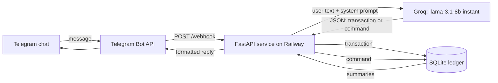

<h1 align="center">Finance Bot</h1>
<p align="center">A personal Telegram bot that turns everyday messages like "makan siang 25rb" into ledger entries using an LLM, with on-demand daily and monthly recaps.</p>
<p align="center">


</p>

> Showcase only. The source is not published because the working copy sits next to real personal finance data.

## Overview
Logging expenses in a spreadsheet or app form is tedious enough that it gets skipped. This bot lets me type a short free-text message in Indonesian (amounts like `25rb`, `5jt`) to a Telegram chat; an LLM turns it into a structured transaction, which is stored and summarised back to me.

## Features
- Free-text input in Indonesian with amount shorthand (`rb`/`k` = thousand, `jt` = million).
- LLM classifies each message as either a transaction (type, category, short description, integer amount in rupiah) or a command.
- Fixed category set: Makan, Transport, Belanja, Tagihan, Hiburan, Kesehatan, Pendidikan, Gaji, Freelance, Transfer, Investasi, Lainnya.
- Commands: daily recap, monthly recap, remaining balance, top expense categories (top 5).
- Confirmation reply after each entry, including the running total for the day.
- FastAPI webhook service deployed on Railway; the webhook is registered with Telegram on startup.

## How it works


## Design notes
**Telegram or WhatsApp?** The current service in the code is a Telegram bot. The project began as a WhatsApp bot (git history: "init: WA keuangan bot", then "feat: switch to Telegram bot"); the repo and folder names still say `wa-`. A separate earlier Node.js prototype using the Baileys WhatsApp library exists as a sibling project and is not part of this showcase.

**Parsing prompt to row.** The system prompt tells the model to return only JSON in one of two shapes: `{"type":"transaction","tipe":...,"kategori":...,"deskripsi":...,"jumlah":...}` or `{"type":"command","command":...}`. It lists the allowed categories and commands, gives the unit conversions, and has a few input/output examples. The request uses temperature 0 and a 200-token cap to keep output short and deterministic. The reply is stripped of any code fences and parsed with `json.loads`; if parsing or the API call fails, the user simply gets the help text.

**Dispatch.** The webhook handler reads the Telegram message, calls the parser, then branches on `type`. A transaction is inserted into a `transaksi` table (timestamp, type, category, description, amount, sender chat id) and the bot replies with a confirmation plus the day's totals. A command runs one of a few aggregate queries filtered by sender and by date prefix (`YYYY-MM-DD` or `YYYY-MM`), and the result is formatted into a Markdown message. All queries are scoped to the sender's chat id.

**Storage, honestly.** The ledger module is named `sheets_service`, but in the final code it writes to SQLite, not Google Sheets. Setup scripts and an example env file in the repo are leftovers from an earlier version that used Gemini, Fonnte (WhatsApp gateway) and Google Sheets. Recaps are produced when asked; the Telegram service has no scheduler.

Sanitised excerpt of the parsing step (prompt shortened):

```python
SYSTEM_PROMPT = """Extract the user's message and return ONLY valid JSON.
Transaction: {"type":"transaction","tipe":"pengeluaran"|"pemasukan",
  "kategori":"Makan/Transport/...","deskripsi":"max 30 chars","jumlah":integer_rupiah}
Command: {"type":"command","command":"rekap_hari"|"rekap_bulan"|"sisa_budget"|"top_pengeluaran"|"bantuan"}
Units: rb/ribu/k = x1000, jt/juta = x1000000"""

def parse_message(message: str) -> dict:
    response = client.chat.completions.create(
        model="llama-3.1-8b-instant",
        messages=[{"role": "system", "content": SYSTEM_PROMPT},
                  {"role": "user", "content": message}],
        max_tokens=200, temperature=0)
    raw = response.choices[0].message.content.strip().strip("```json").strip("```").strip()
    return json.loads(raw)
```

## Getting started
Not published and not re-run for this showcase. For reference, the service needs Python, `fastapi`, `uvicorn`, `groq`, `httpx`, `python-dotenv`, environment variables for the Telegram bot token, the Groq API key and the public webhook URL, and starts with `uvicorn main:app --host 0.0.0.0 --port $PORT`.

## Project context
Solo personal project, 2026. Designed and built by me; hosted on Railway.

## Limitations
- Single-model parsing with no schema validation beyond `json.loads`; an unexpected model output falls back to the help message.
- SQLite on a hosted container needs a persistent volume to survive redeploys.
- No scheduled recaps, budgets per category or edit/delete of entries in the Telegram version.
- Amounts are integers in rupiah; no multi-currency support.

## License
MIT (applies to this README).
